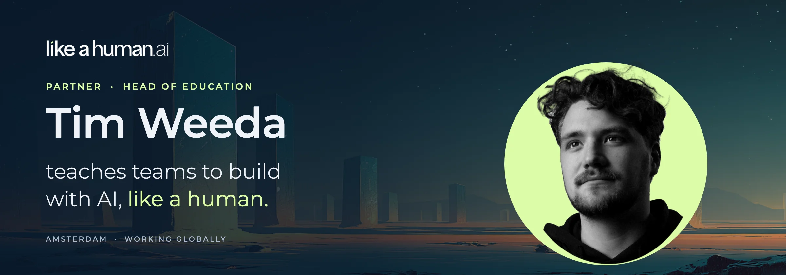
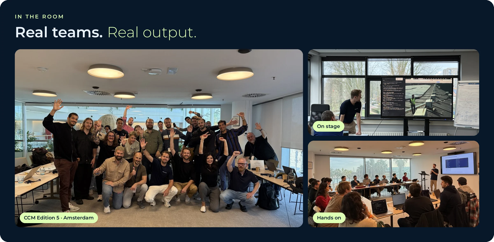
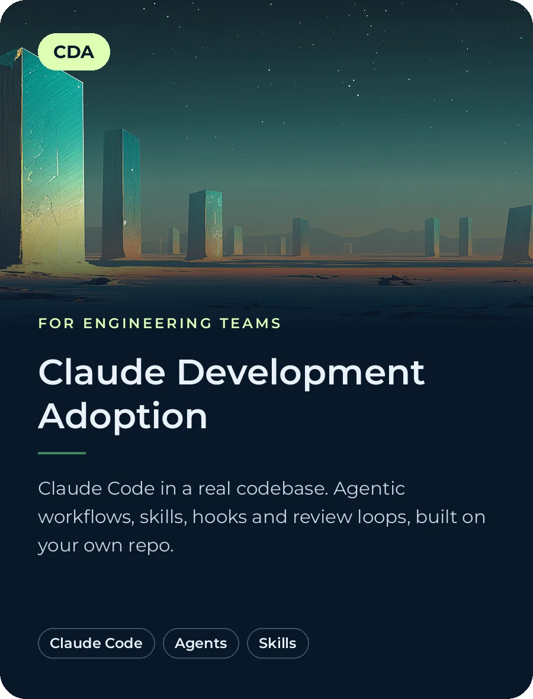
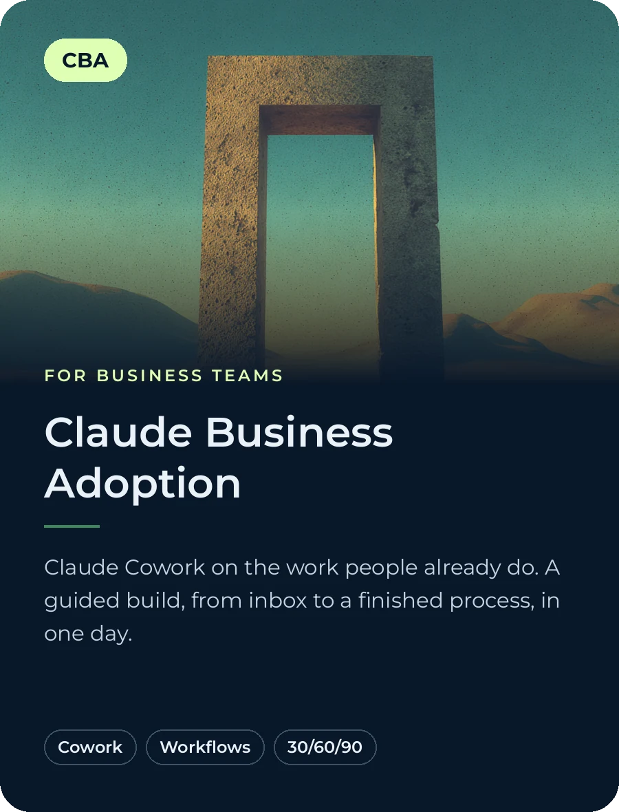
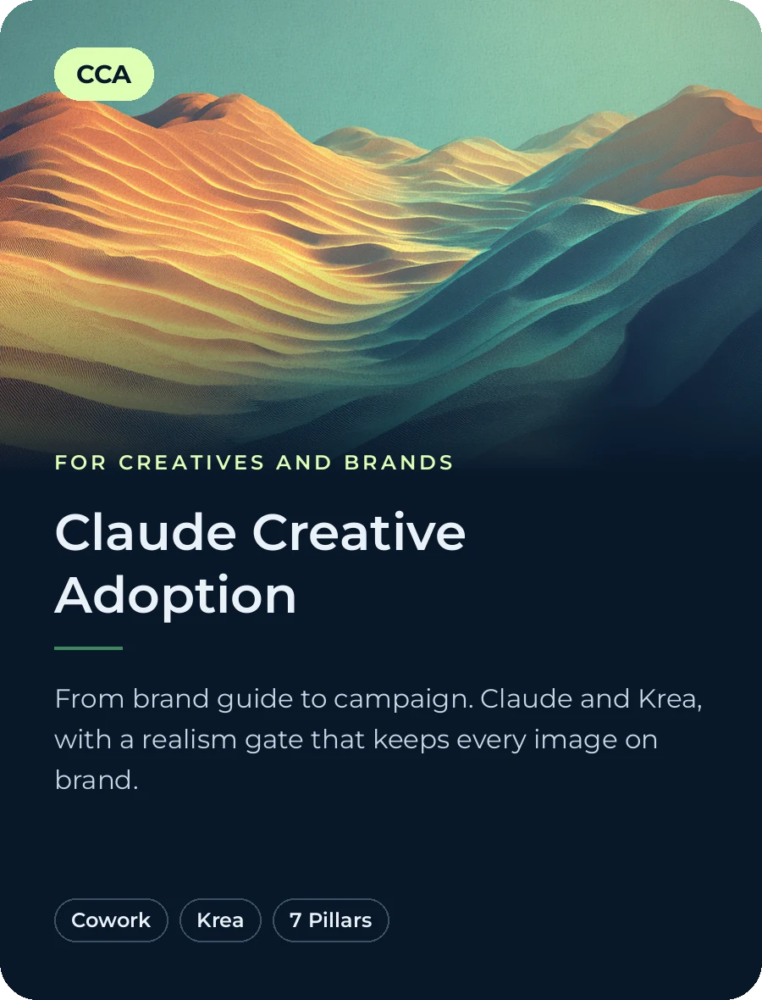
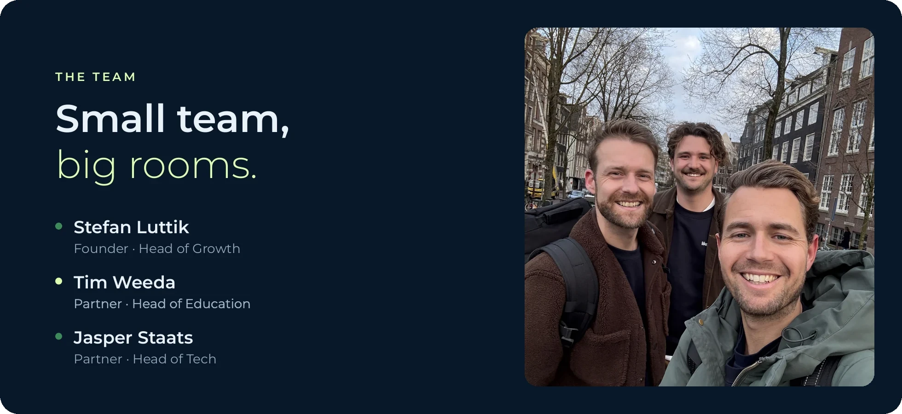
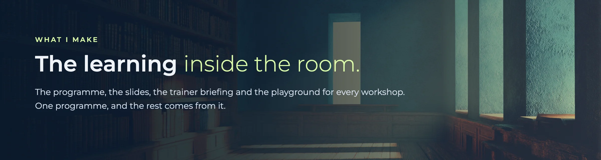
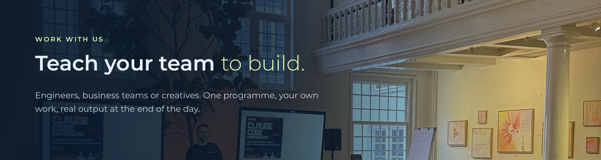

  

  <a href="https://likeahuman.ai"><strong>likeahuman.ai</strong></a>
  &nbsp;·&nbsp;
  <a href="https://www.linkedin.com/in/tbjwvdb/"><strong>LinkedIn</strong></a>

 

### Like A Human

We run hands-on AI programmes. Teams do not watch a demo: they build with Claude on their own work, and they leave with real output. Three programmes, one for each kind of team.

  

 

  
  
  

| | Programme | For | What the team builds |
|---|---|---|---|
| **CDA** | Claude Development Adoption | Engineering teams | Claude Code in their own repo: agents, skills, hooks, review loops |
| **CBA** | Claude Business Adoption | Business teams | A finished process in Claude Cowork, from inbox to output |
| **CCA** | Claude Creative Adoption | Creatives and brands | A brand-true campaign with Claude and Krea, through a realism gate |

 

  

Built and led by <a href="https://www.linkedin.com/in/stefanluttik/"><strong>Stefan</strong></a>, <a href="https://www.linkedin.com/in/tbjwvdb/"><strong>Tim</strong></a> and <a href="https://www.linkedin.com/in/jasperstaats/"><strong>Jasper</strong></a>.

 

  

### What I make

I come from legal tech and the Dutch government. Today I build full-time with Claude Code. As Partner and Head of Education, I make what a team learns on the day:

- **The programme.** One programme per workshop, fitted to the team and its own work.
- **The slides.** They come from the programme, not from a second copy.
- **The trainer briefing.** Every trainer in the room knows the plan, the timing and the traps.
- **The playground.** Where participants try each step on their own work before they build it for real.

 

  

 

  

  <a href="https://likeahuman.ai"><strong>Book a programme</strong></a>
  &nbsp;·&nbsp;
  <a href="https://www.linkedin.com/in/tbjwvdb/"><strong>Talk to me</strong></a>
   
  Amsterdam · working globally

